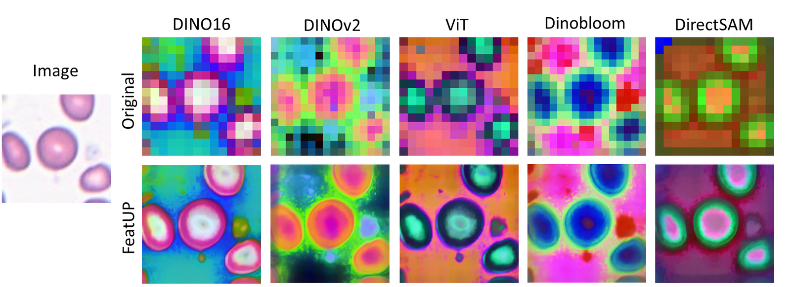
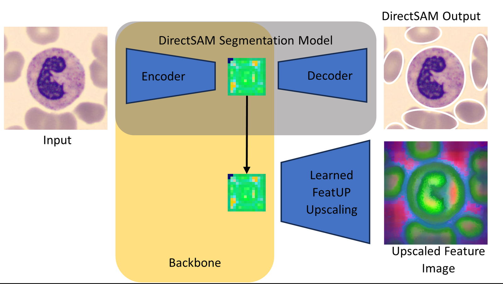
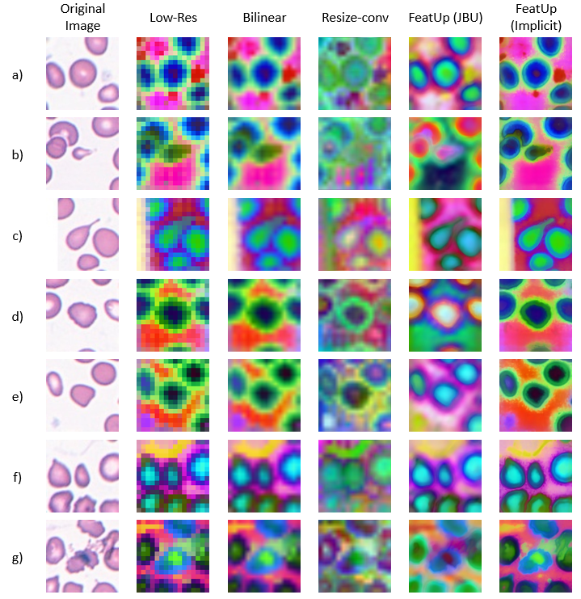

# FeatUp-cell

**Feature upsampling for blood cell images with domain-specific backbones**
Code for my Bachelor's thesis *"Weakly Supervised Instance Segmentation of Out-of-Distribution Data of Red Blood Cells"* (TUM, Helmholtz Munich / Marr Lab, 2024, grade 1.3).

This repository is a fork of [FeatUp](https://github.com/mhamilton723/FeatUp) (Fu, Hamilton et al., ICLR 2024). I added two new backbones – **DinoBloom** and **DirectSAM** – and used FeatUp to upsample their feature maps for white and red blood cell microscopy images.


*Low-resolution backbone features (top) vs. FeatUp-upsampled features (bottom, implicit upsampler) on a red blood cell image. DinoBloom and DirectSAM separate cells from the background most clearly.*

---

## Motivation

Around 20% of complete blood counts still need manual review by experts, and red blood cell shape is an important diagnostic signal (e.g. teardrop-shaped or fragmented cells). Vision transformers produce useful features for this, but only at low resolution (14×14 for a 224×224 image), which is too coarse to capture cell boundaries. FeatUp restores high-resolution feature maps without changing their semantics.

The question of the thesis: **Do backbones built for blood cells or for segmentation give better upsampled features for red blood cells than general-purpose backbones – even when the data is out of distribution?**

## What I did

- **Integrated two new backbones into FeatUp**
  - **DinoBloom** ([marrlab/DinoBloom](https://github.com/marrlab/DinoBloom)) – a DINOv2 ViT-S/14 trained on hematology images, mostly white blood cells. Heads removed, features reshaped to FeatUp's format (patch size 14, 384 dims).
  - **DirectSAM** (`chendelong/DirectSAM-1800px-0424`) – a SegFormer-based boundary segmentation model. Features are taken from the encoder's hidden states (patch size 14, 320 dims).
- **Trained both FeatUp upsamplers** (Joint Bilateral Upsampler and implicit upsampler, 16× from 14×14 to 224×224) for DinoBloom, DirectSAM and the baselines DINO16, DINOv2 and ViT on the Helmholtz Munich HPC cluster.
- **Evaluated on two datasets**
  - White blood cells (baseline): ~249k images from Matek-19, Acevedo-20, BMC-20 and INT-20, 21 classes
  - Red blood cells (out of distribution for DinoBloom): *1 Million Segmented Red Blood Cells* (Elsafty), ~240k cells from 25 blood smears, 9 shape classes, 4 different cameras
- **Compared against baseline upsampling** (bilinear, resize convolution).


*Extracting encoder features from DirectSAM so it can be used as a FeatUp backbone.*

## Results (qualitative)


*Red blood cells of different shapes (rows) with DinoBloom features: low-resolution, bilinear, resize convolution, FeatUp JBU and FeatUp implicit.*

- FeatUp produced sharper, more detailed feature maps than bilinear upsampling and resize convolution for all backbones; the implicit upsampler gave the sharpest results.
- **DinoBloom** showed the highest contrast between cells and background on red blood cells, even though it was trained mainly on white blood cells – a sign of good generalization.
- **DirectSAM** gave the clearest cell boundaries and the most uniform background, which makes it a good candidate for downstream segmentation.

**Limitations:** Training ran for 2,000 steps and did not use the full datasets, and the evaluation is qualitative only. Natural next steps are using the feature maps in an actual segmentation model, measuring IoU/mAP, and fine-tuning the backbones on red blood cell data.

## Running it

Setup and training work as in the original FeatUp repository (see [upstream README](https://github.com/mhamilton723/FeatUp#readme)):

```bash
git clone https://github.com/IIISethIII/FeatUp-cell.git
cd FeatUp-cell
pip install -e .

cd featup
python train_jbu_upsampler.py        # Joint Bilateral Upsampler
python train_implicit_upsampler.py   # implicit upsampler
```

The backbone and dataset are selected in the config files in `featup/configs/`. Notes on running this on the Helmholtz Munich cluster are in `helmholtz_cluster_setup.txt`.

## Credits

- FeatUp: Stephanie Fu, Mark Hamilton, Laura Brandt, Axel Feldmann, Zhoutong Zhang, William T. Freeman – [paper](https://openreview.net/forum?id=GkJiNn2QDF), [code](https://github.com/mhamilton723/FeatUp) (MIT License)
- DinoBloom: Marr Lab, Helmholtz Munich
- Thesis supervision: Dr. Umer Rao Muhammad and Dr. Carsten Marr (Helmholtz Munich); examiner Prof. Dr. Fabian J. Theis (TUM)

```bibtex
@inproceedings{fu2024featup,
  title     = {FeatUp: A Model-Agnostic Framework for Features at Any Resolution},
  author    = {Stephanie Fu and Mark Hamilton and Laura E. Brandt and Axel Feldmann and Zhoutong Zhang and William T. Freeman},
  booktitle = {The Twelfth International Conference on Learning Representations},
  year      = {2024},
  url       = {https://openreview.net/forum?id=GkJiNn2QDF}
}
```
